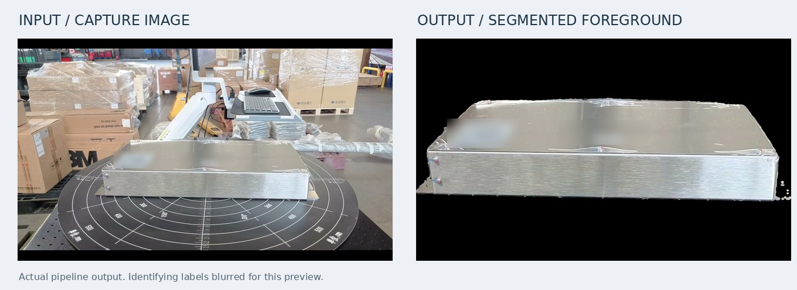
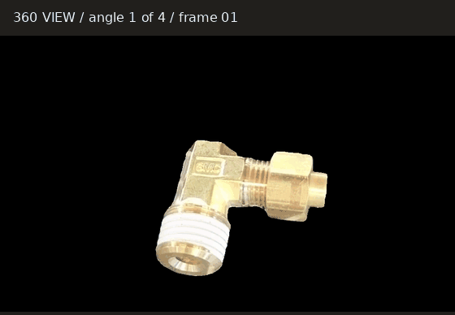
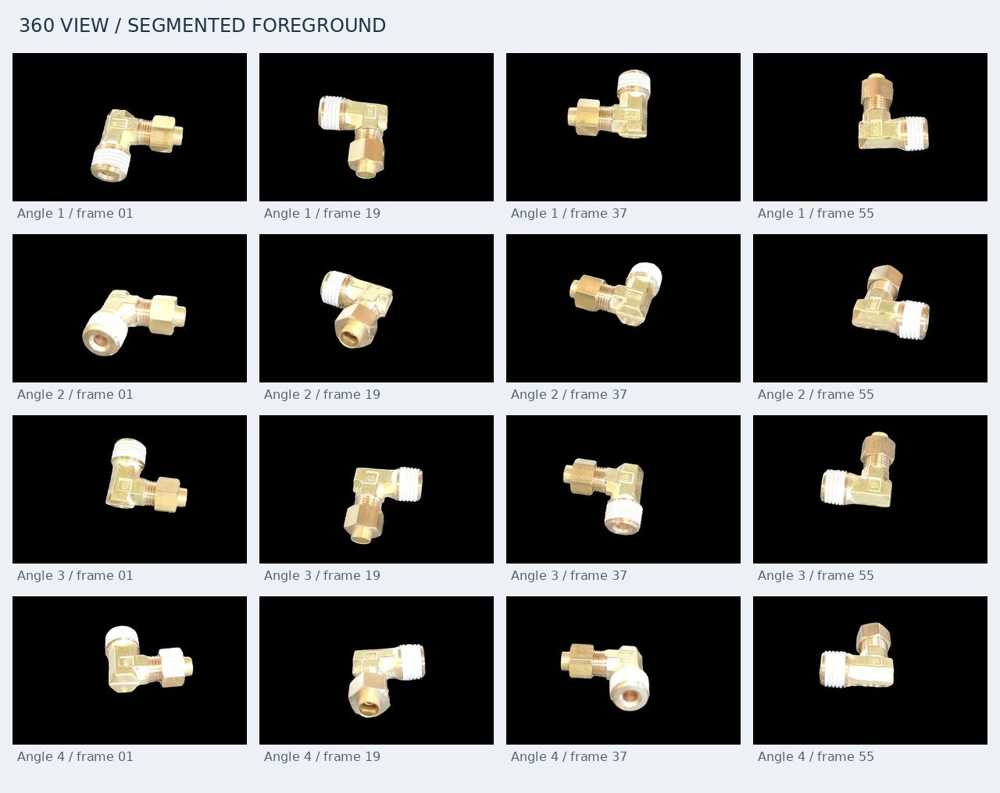
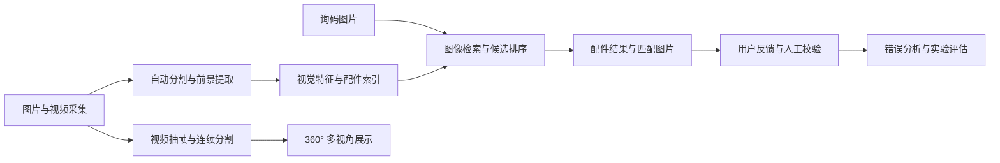

# 铁路配件智能识别与视觉检索系统

面向铁路配件采集与询码的计算机视觉项目：将现场拍摄的图片与配件图库进行匹配，返回候选配件及对应图片；同时将采集视频自动处理为可交互的 360° 多视角展示。

项目覆盖从数据采集、自动分割、特征提取、向量检索，到结果审核和索引更新的完整流程。算法重点是 **多模型图像检索、自动前景分割、视频生成 360° 视图**。主服务负责业务与任务调度，模型服务独立部署。

> 本文为面向 GitHub 的技术介绍。现有运行说明见 [README.md](README.md)。文中区分已实现功能与独立研究实验，实验指标不代表线上总体识别准确率。

## 核心算法能力

### 1. 多模型图像检索：利用不同视觉模型的互补能力

**要解决的问题：** 同一种配件有多个拍摄角度，询码照片又包含不同的背景、距离和铭牌信息。单一模型容易漏检，而且同一配件的多张图片不应重复占据候选名额。

**实现方式：**

- 使用 **SigLIP** 提取 1,152 维图片特征，使用 **DINOv2-large** 提取 1,024 维整图特征，并保留局部图片特征。
- 按配件组织图片索引，将图片相似度汇总到配件编码；同一配件的多张图片最终对应一个候选。
- 支持 SigLIP、DINOv2 及混合检索。混合检索通过 RRF 合并排名：候选在各路越靠前、得到的支持越多，避免直接比较不同模型的原始分数。
- 实现 DINOv2 局部特征重排：比较询码图与候选图的局部特征，每个询码局部取最佳匹配，再汇总相似度，补充整图特征难以表达的细节。

**输出结果：** 按匹配程度排列的配件编码、名称、对应图库图片，以及命中的询码图片位置。保留图片证据，便于人工判断识别依据。

在独立研究实验中，进一步验证了 **图片分类分流** 和 **Qwen3-VL 图片重排**：先判断每张照片属于近景、远景还是铭牌，再组合检索与重排。相关结果见后文；这些实验不等同于生产默认配置。

实现入口：[向量检索与排名融合](csrcqsf/modules/railway_parts/vector_search/storage/milvus_manager.py)。

### 2. 自动前景分割：从复杂背景中提取配件



左侧为现场采集原图，右侧为同一图片经过自动分割、去背景和裁切后的结果。展示图已缩放，并对配件标识作模糊处理；保留实际分割边缘，没有人工修补掩码。

**要解决的问题：** 原始采集图片包含转盘、工作台等背景，直接提取特征可能让模型关注背景。逐张人工抠图又难以支撑持续采集。

**实现方式：**

1. 使用 **YOLO-World** 根据工业物体提示定位配件，获得目标框。
2. 将目标框交给 **SAM2**，生成并选择前景掩码。
3. 针对转盘采集中的误分割，使用 SigLIP 判断是否误选转盘，并通过补充正负提示点重新分割。
4. 对掩码进行闭运算、膨胀和裁切，生成统一黑色背景的配件图，再提取视觉特征。
5. 未检测到目标或掩码为空时，按已定义的分支回退到原图，保留后续建库能力。

**输出结果：**

| 产物 | 用途 |
| --- | --- |
| 前景 PNG | 检索建库与分割效果审核 |
| 目标框、掩码面积、检测分数、选用提示词 | 追踪分割结果与排查错误 |
| SigLIP 图片向量 | 图片相似度检索 |
| DINOv2 整图向量与局部特征 | 候选召回与局部特征重排 |

模型服务提供 `/api/v1/indexing/extract`，主服务负责保存分割图、特征和配件关联关系，并管理索引任务。

当前流程主要适配采集图片，包含针对转盘场景的处理；复杂询码照片的自动定位与分割属于后续适配方向。目前没有独立的分割 IoU 测试结果，不以检索指标代替分割精度。

实现入口：[配件索引服务](csrcqsf/modules/railway_parts/services/parts_index_service.py)、[分割图片管理](csrcqsf/modules/railway_parts/services/segmented_image_service.py)。模型推理实现在独立的 `RecognitionModelService` 项目中。

### 3. 视频生成 360° 视图：将采集过程转为可查看的算法产物



自动分割后的旋转预览：从一个配件的 4 组、共 288 张透明背景视图中抽取 48 帧，保留分割掩码、去掉转盘和现场背景，再统一裁切展示范围，制作黑色背景的 GIF。使用实际分割结果，没有人工修补掩码。网页中可通过拖动切换角度；这里使用 GIF，方便在 GitHub 直接查看。

<details>
<summary>展开查看 4 组拍摄角度的静态图片</summary>



每行对应一组拍摄角度，每列选取一个旋转位置。图片来自实际导出的透明背景视图序列，在黑色底色上展示分割后的配件。

</details>

**要解决的问题：** 一段原始视频不方便按角度查看配件，逐帧制作展示图又需要大量人工处理。不同角度的图像还存在背景干扰和位置偏移。

**实现方式：**

1. 根据视频时长和拍摄配置划分不同角度片段，跳过角度切换区间，使用 FFmpeg 抽帧。
2. 自动定位首帧目标，使用 SAM2 在连续帧之间传播分割掩码。
3. 合成前景图片，按每组掩码中心的统计结果调整位置，减少拖动查看时的主体偏移。
4. 导出 WebP 多视角图片及 `manifest.json`，上传对象存储，供前端按角度切换。

默认配置为 **4 组角度 × 每组 72 帧，共 288 张展示图片**，数量可配置。这是输出规格，不是处理速度指标。

**输出结果：** WebP 图片序列、视角网格清单、资源地址和任务状态。支持采集后的自动触发、已有视频批量补建，以及分阶段进度与断点恢复。

这里的 360° 视图是基于多视角图片的交互展示；真正的三维重建由独立服务承担。

实现入口：[视频处理流程](csrcqsf/modules/railway_parts/services/viewer360_pipeline.py)、[前景合成与对齐](csrcqsf/modules/railway_parts/services/viewer360_grid.py)、[任务管理](csrcqsf/modules/railway_parts/services/viewer360_task_manager.py)。

## 算法实验与结果

### 实验一：677 条真实询码的纯图像检索对比

**检索图库：471 个配件、8,896 张图片。测试集：677 条询码、2,526 张不同的询码图片。**

图库使用基础信息和人工上传图片，查询使用询码记录图片。实验只输入图片，不使用名称、车型、BGE、Agent 或生成名称。正确编码仅在检索结束后用于评分。

同一配件取多图组合中的最高余弦相似度，按不同配件编码排名。DINOv2 本轮只使用整图特征，没有使用局部特征重排。

| 正确编码召回率 | SigLIP | DINOv2 整图特征 |
| --- | ---: | ---: |
| Top1 | **28.21%（191/677）** | 23.49%（159/677） |
| Top5 | **51.26%（347/677）** | 46.23%（313/677） |
| Top10 | **59.68%（404/677）** | 54.21%（367/677） |
| Top20 | **68.69%（465/677）** | 61.30%（415/677） |
| MRR@20 | **0.386847** | 0.336869 |

**关键发现：模型存在互补，不能简单替换。** DINOv2 另外找回了 SigLIP 未命中的 57 条。两路各取前 20 名，合并后的覆盖率为 **77.10%（522/677）**；合并后最多有 40 个候选，这不是最终 Top20 召回率。

询码图片与图库图片的文件级 SHA-256 完全重复数为 0；这项检查不能排除所有视觉近重复。测试集限于正确编码属于当前图库且具备可用图片的询码，不代表平台全部询码分布。

### 实验二：50 条询码的分类、融合与图片重排

本轮为独立研究实验，使用同一完整图库，测试 **50 条询码、161 张图片**，不使用业务文字。与早期使用 205 张图片的 50 条实验不是同一组输入。

- **图片分类：** Valen-0.8B 一次查看同一询码的全部图片，逐张判断近景、远景和铭牌。
- **分类分流：** 近景交给 DINOv2，远景与铭牌交给 SigLIP，通过 RRF 合并为前 20 个不同编码。
- **图片重排：** Qwen3-VL-Reranker-2B 比较查询图与候选图库图，重新排列这 20 个候选，不接收配件编码、名称或正确答案。

| 方案 | Top1 | Top5 | Top10 | Top20 |
| --- | ---: | ---: | ---: | ---: |
| SigLIP：全部图片 | 34%（17/50） | 48%（24/50） | 56%（28/50） | 64%（32/50） |
| DINOv2：全部图片 | 28%（14/50） | 58%（29/50） | 60%（30/50） | 62%（31/50） |
| 分类分流并融合 | 22%（11/50） | 44%（22/50） | 52%（26/50） | **70%（35/50）** |
| 分类分流、融合，再做图片重排 | 42%（21/50） | 64%（32/50） | **68%（34/50）** | **70%（35/50）** |
| 不分类，两模型检索全部图片、融合并重排 | **48%（24/50）** | **66%（33/50）** | 66%（33/50） | 68%（34/50） |

**最明确的收益来自重排：** 固定分类分流得到的 20 个候选后，Top1 从 22% 提高到 42%，Top5 从 44% 提高到 64%，均提高 **20 个百分点**。候选集合没有改变，因此 Top20 保持不变。

不分类的双模型方案取得了本轮更高的 Top1 和 Top5，分类分流则在 Top20 多命中 1 条。由此不能认定分类分流全面优于全图检索。将重排候选扩大到 50 个后，最终 Top20 反而降为 66%，本次没有获得扩容收益。

这 50 条用于反复比较方案，结果应视为探索性结论；还需要在独立保留集上验证。上述指标也不能用于证明分割或局部特征重排的收益，因为本轮没有测试这些改动。

### 评测方法

- **按编码评分：** 返回编码与正确编码完全一致才算命中，同名不同编码不算正确。
- **按配件去重：** 同一配件的多张图库图片只占一个候选位置。
- **TopK：** 正确编码进入前 K 名的询码比例；不等同于第一名识别准确率。
- **MRR@20：** 正确编码在前 20 名时取排名倒数，未命中计 0，再对全部询码求平均。
- **人工审核：** 保存查询图、命中图库图及排名，生成网页对照，用于分析漏检、错排和图片重复问题。

本仓库提供[双模型对比脚本](scripts/experiments/compare_dinov2_image_retrieval.py)和[检索得分核验脚本](scripts/experiments/audit_image_retrieval_scores.py)。分类与 Qwen 图片重排实验在配套 `searchCode-agent` 项目中完成；本 README 记录结果，运行仍需对应脚本、模型权重与授权数据。文档只附少量缩放后的效果样例，分割对照中的配件标识已作模糊处理；完整业务原图及询码记录不随公开介绍发布。

## 从算法到业务闭环



工程实现还包括：

- **索引生命周期管理：** 全量构建、增量更新、任务进度、取消与失败重试。
- **结果可追溯：** 保存检索参数、候选快照、对应图片与用户反馈，支持错误结果再次检索和人工校验。
- **数据持续更新：** 同步配件基础信息、图片、车型、供应商、父子关系和库存位置，为检索与采集提供业务信息。
- **大文件采集：** 视频分片上传、对象存储和异步处理，避免长任务阻塞接口。

反馈数据用于审核与分析；当前不把反馈后自动训练模型作为已实现能力。

## 技术架构

| 层次 | 技术与职责 |
| --- | --- |
| 业务主服务 | Python、FastAPI：接口、业务规则、任务调度与结果管理 |
| 独立模型服务 | PyTorch、Transformers：YOLO-World、SAM2、SigLIP、DINOv2、OCR、BGE-M3 |
| 向量检索 | Milvus：图片及文本向量索引 |
| 数据与文件 | MySQL、Redis、MinIO：业务记录、任务协作与图片视频存储 |
| 视频处理 | FFmpeg、WebP：抽帧、多视角图片输出 |
| 研究实验 | Valen-0.8B、Qwen3-VL-Reranker-2B：图片分类与视觉重排 |

主服务与 GPU 模型推理解耦，可以分别扩容和更新。三维重建也由独立服务提供，与基于图片序列的 360° 展示分别管理。

## 运行入口

准备 MySQL、Redis、Milvus、MinIO，并单独启动所需模型服务，再安装和配置主服务：

```bash
uv sync
cp .env.example .env
# 配置数据库、对象存储、向量库、认证及模型服务地址后启动
RECOGNITION_ENV_FILE=.env uv run python -m csrcqsf
```

接口参数、服务依赖及部署方式见 [现有 README](README.md) 和 [部署文档](部署文档.md)。模型权重、业务数据与访问凭据需单独准备。
